# Auswertung entlang der Forschungsfragen: claude-haiku-5-5_low_batch_all

2262 Twin-Paare (ESS 11 DE ↔ Twin). Items umgepolt (6 = sehr wichtig), Fehler = Twin − Person. Erzeugt mit `python -m ess_pipeline.analysis.forschungsfragen`. Alle Kennzahlen: `kennzahlen.csv`, je Twin (`mae`, `mae_gezogen`, `spearman`, `cluster_twin`, …): `twins.csv`.

**Datengrundlage.** Gezogene Antwort = die Antwort, die aus den sechs Wahrscheinlichkeiten des Modells ausgelost wurde; Erwartungswert = Σ k · pk, der Schwerpunkt dieser Wahrscheinlichkeiten ohne Zufall der Ziehung. **Ebene 1 rechnet mit Erwartungswerten:** Mittelwert und Demografie-Mittelwert sind selbst Erwartungswerte, gegen die gezogene Antwort trüge nur der Twin das Rauschen der Ziehung, und das enthält per Konstruktion keine Information über die Person. Der fremde Twin wird ebenfalls aus Erwartungswerten gebildet. **Ebene 2 rechnet mit gezogenen Antworten,** denn dort geht es um die synthetische Stichprobe als Datensatz. Beide Varianten stehen nur dort nebeneinander, wo der Unterschied selbst der Befund ist (1a, 1e, A2, 2b, Fazit 3). In Fazit 3 sind gezogene Antworten die untere, Erwartungswerte die obere Schranke. Der Erwartungswert ist nur dann die passende Punktprognose, wenn die verbalisierten Wahrscheinlichkeiten halbwegs kalibriert sind. **Ebene 1 steht im Anhang vollständig auch mit gezogenen Antworten (Sensitivitätsanalyse);** 3 von 9 geprüften Aussagen hängen von dieser Wahl ab, alle beim Vergleich mit dem Demografie-Mittelwert in 1b, A3 und 1b′.

**Vergleichsgrößen in Ebene 1.** Der *fremde Twin* (Twin einer anderen Person) ist die Untergrenze: Twin und fremder Twin teilen Modell, Prompt und systematischen Fehler, der Unterschied ist also die Wirkung des Profils. Der *Demografie-Mittelwert* (mittlere Antwort der anderen Personen gleichen Geschlechts, Alters und Bildungsgrads) ist die Messlatte: Weiß der Twin mehr als drei Merkmale? Er kennt nichts über die Person, aber die echten Antworten aller anderen Befragten, die dem Modell fehlen. Der Mittelwert aller Personen steht nur in 1a als anschaulicher Bezug.

| Nr. | Abbildung | Kurzantwort |
|---|---|---|
| A1 Beispielperson | `A1_beispielperson` | So entsteht ein Twin: sechs Wahrscheinlichkeiten je Frage, daraus eine gezogene Antwort |
| 1a Genauigkeit | `FF1a_genauigkeit` | MAE 1,06 (gezogen 1,34); besser als fremder Twin (1,18), schlechter als Demografie-Mittelwert (0,92) und Mittelwert (0,95) |
| 1b Profil | `FF1b_profil` | ρ̄ = 0,50; individuelle Abweichung ρ̄ = 0,19 (gleichauf mit dem Demografie-Mittelwert 0,17) |
| A3 Fehler je Twin | `A3_fehler_je_twin` | 25 % der Twins genauer als der Demografie-Mittelwert, bei der individuellen Abweichung 51 % besser |
| 1c Bias | `FF1c_bias` | 16/21 Fragen gerichtet, davon 14 unterschätzt |
| A2 Varianzzerlegung | `A2_varianzzerlegung` | nur 30 % der Twin-Varianz unterscheidet die Twins voneinander, der Rest ist Zufall der Ziehung |
| 2.0 Milieus | `FF2_0_milieus_existenz` | Silhouette Personen 0,163 = Zufallsdaten ohne Gruppen → Kontinuum; Twins spalten sich; k = 2 gesetzt |
| 2.1 Milieus im Wertekreis | `FF2_1_milieus` | Milieu 1 (offen) oben, Milieu 2 (bewahrend) unten; Twins streuen weiter und rutschen Richtung Bewahrung |
| 2a Lage | `FF2a_lage` | Twins um 1,22 verschoben = 53 % des Abstands der Personen-Milieus; Milieu-Größen kippen (Milieu 1 (offen): Personen 55 %, Twins 39 %) |
| 2b Streuung | `FF2b_streuung` | tr(Σ) Twin/Person × 1,39 (gezogen), × 0,61 (Erwartungswerte) |
| 2d Zuordnung | `FF2d_zuordnung` | 62 % im Milieu der Person (Zufall 49 %); ARI 0,054 |
| Fazit 3 Werte oder Demografie | `Fazit3_werte_oder_demografie` | Demografie erklärt bei den Twins mehr Wertevarianz: gezogen bis 4,3×, Erwartungswerte bis 9,5×; größter Abstand: Hedonismus, Stimulation, Konformität |
| *Anhang* 1b′ Trennschärfe | `FF1b2_trennschaerfe` | ρ̄ über Personen = 0,20; 17/21 Fragen besser als der Demografie-Mittelwert |
| *Anhang* 1d Subgruppen | `FF1d_subgruppen` | signifikant: Werte-Milieu (η² = 0,040), Schulabschluss (η² = 0,039), Religion (η² = 0,007), Alter (η² = 0,007), Region (η² = 0,007); Demografie erklärt R² = 5,7 % des MAE |
| *Anhang* 1e Varianzkollaps | `FF1e_varianzkollaps` | gezogene Antworten streuen bei 17 Fragen weiter als bei Personen, die Erwartungswerte bei 21 Fragen enger |
| *Anhang* 2c Form | `FF2c_form` | MMD² 0,0585, p ≤ 0,002 |
| *Anhang* Sensitivität | – | Ebene 1 mit gezogenen Antworten: 3 von 9 Aussagen hängen von der Wahl ab, alle beim Vergleich mit dem Demografie-Mittelwert (1b, A3, 1b′) |

## Ebene 1 · Twin ↔ Person

### A1 Beispielperson
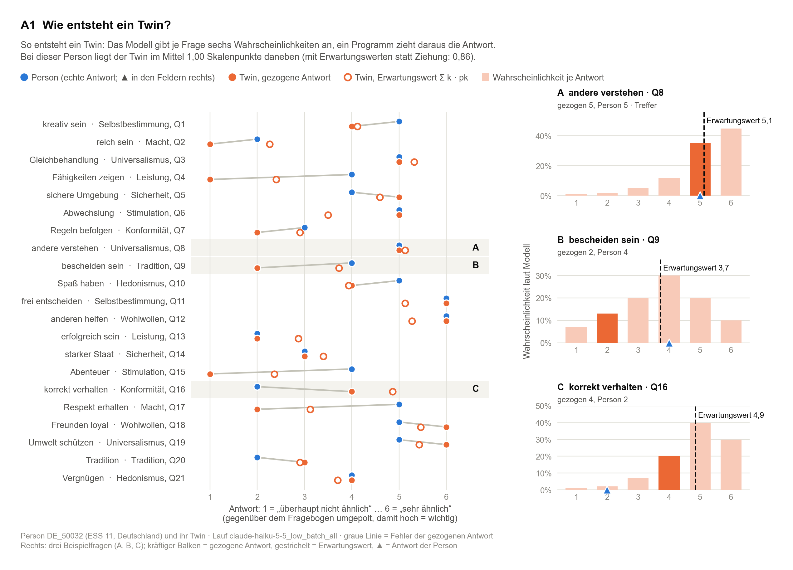

*Beschreibung.* Für jede Frage gibt das Modell sechs Wahrscheinlichkeiten an; ein Programm lost daraus die Antwort des Twins aus. Der Erwartungswert Σ k · pk ist der Schwerpunkt dieser Wahrscheinlichkeiten, die gezogene Antwort kann zufällig weit davon entfernt liegen. Links stehen die 21 Antworten der Person (blau) und ihres Twins (orange gefüllt = gezogen, Ring = Erwartungswert), die graue Linie ist der Fehler; rechts sind drei Fragen aufgeschlüsselt. Alle folgenden Abbildungen sind Zusammenfassungen solcher Paare.

### 1a Absolute Genauigkeit
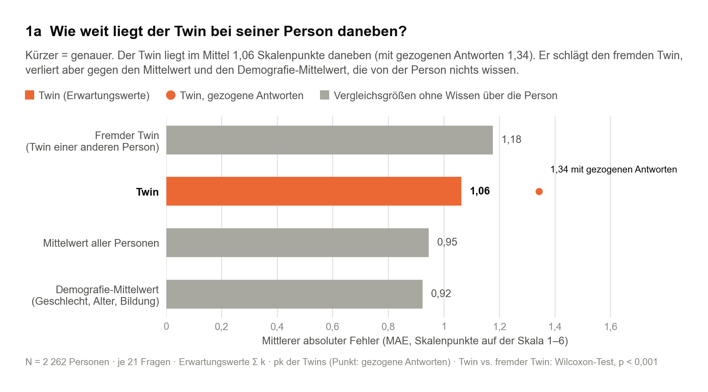

*Beschreibung.* Der Twin liegt im Mittel 1,06 Skalenpunkte neben der Antwort seiner Person, mit gezogenen Antworten 1,34; die Differenz ist allein der Preis der Ziehung. Der MAE ist der mittlere Abstand zwischen Twin- und Personenantwort in Skalenpunkten; die grauen Vergleichsgrößen wissen nichts über die Person. Kürzere Balken bedeuten genauer.

Der Twin ist genauer als ein fremder Twin (1,18; 74 % der Twins sind genauer, Wilcoxon p < 0,001), aber schlechter als der Demografie-Mittelwert (0,92) und der Mittelwert aller Personen (0,95). Das liegt nicht an der Ziehung: Verglichen werden hier Erwartungswerte mit Erwartungswerten. Zum Vergleich: Würfeln ergäbe 1,88.

### 1b Profilähnlichkeit
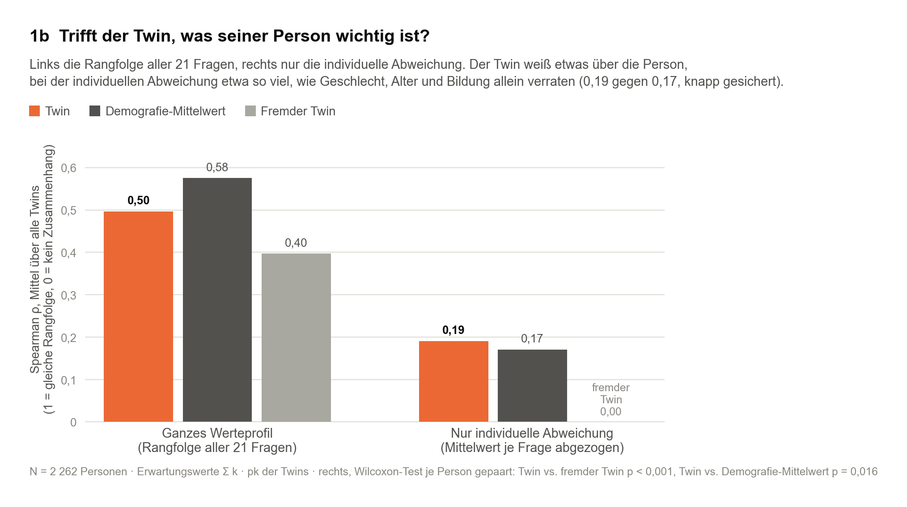

*Beschreibung.* Der Twin trifft die Rangfolge der 21 Fragen mit ρ̄ = 0,50, die individuelle Abweichung mit ρ̄ = 0,19. Spearman ρ vergleicht die Rangfolge der Fragen zwischen Twin und Person (1 = gleiche Rangfolge, 0 = kein Zusammenhang). Die rechte Gruppe gibt es, weil fast alle Personen Wohlwollen wichtig und Macht unwichtig finden; darum erreicht links schon der fremde Twin 0,40, rechts ist dieser gemeinsame Teil abgezogen.

Nach Abzug des Mittelwerts je Frage bleibt ρ̄ = 0,19 (fremder Twin 0,00, p < 0,001). **Der Twin enthält also Information über die Person**, etwa so viel, wie der Demografie-Mittelwert trägt (ρ̄ = 0,17). Mit gezogenen Antworten wären es nur 0,12: Das Rauschen der Ziehung verdeckt einen Teil dieser Information. **Die Rangfolge gegenüber dem Demografie-Mittelwert hängt damit von der Wahl ab:** mit Erwartungswerten liegt der Twin knapp darüber, mit gezogenen Antworten darunter (Anhang, Sensitivitätsanalyse). Dass der Twin überhaupt Information über die Person enthält, gilt in beiden Varianten.

### A3 Fehler je Twin
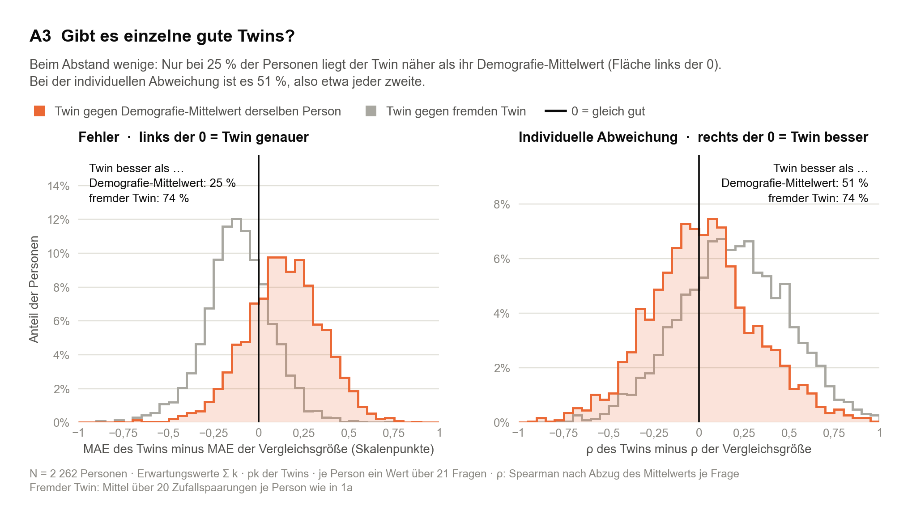

*Beschreibung.* 25 % der Twins liegen näher an ihrer Person als deren Demografie-Mittelwert, bei der individuellen Abweichung sind 51 % besser als er. Gezeigt ist je Person die Differenz Twin minus Vergleichsgröße derselben Person, für den MAE (links) und das ρ der individuellen Abweichung (rechts); orange gegen den Demografie-Mittelwert, grau gegen den fremden Twin. Die Fläche auf der guten Seite der 0 ist der Anteil der Twins, die besser sind (links der 0 genauer, rechts der 0 besser).

### 1c Systematischer Bias
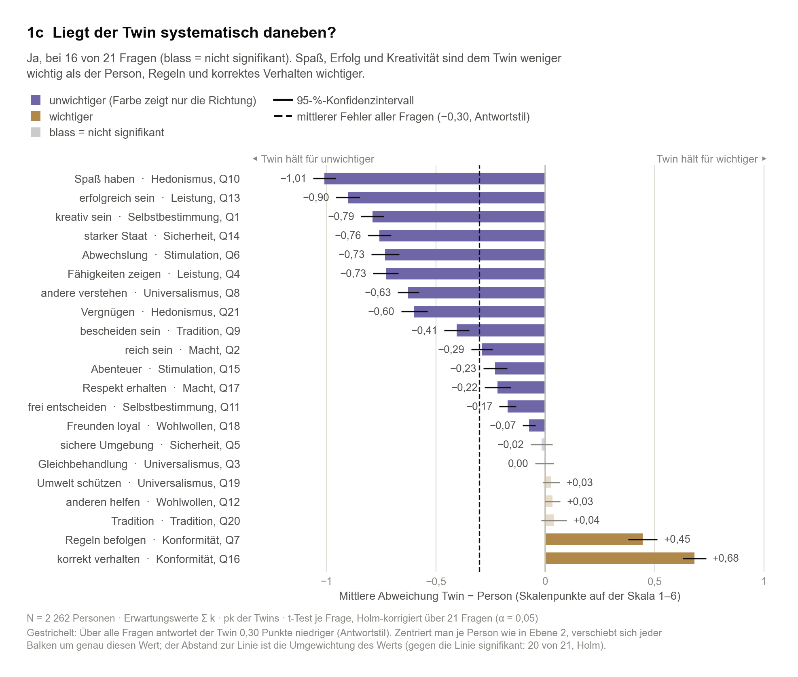

*Beschreibung.* Bei 16 von 21 Fragen liegt der Twin systematisch daneben, bei 14 davon nach unten. Mean Error = Twin minus Person mit Vorzeichen; negativ heißt, der Twin hält den Wert für unwichtiger; −1 ist ein ganzer Punkt auf einer 6er-Skala. Gezogene Antworten haben in Erwartung denselben Mean Error. Signifikanz mit t-Test und Holm-Korrektur über 21 Fragen; die schwarzen Linien sind 95-%-Konfidenzintervalle, die Farbe zeigt nur die Richtung, blasse Balken sind nicht signifikant.

Mean Error gesamt -0,30. Am stärksten unterschätzt: Q10 Spaß haben (Hedonismus, ME -1,01, d = -0,80), Q13 erfolgreich sein (Leistung, ME -0,90, d = -0,67), Q1 kreativ sein (Selbstbestimmung, ME -0,79, d = -0,62), Q14 starker Staat (Sicherheit, ME -0,76, d = -0,59). Überschätzt: Regeln befolgen (Konformität, ME 0,45), korrekt verhalten (Konformität, ME 0,68). Das Muster (Hedonismus, Leistung, Stimulation runter, Konformität hoch) passt zum Bild einer „vernünftigen, angepassten“ Durchschnittsperson. Diese gerichteten Fehler erklären, warum der Twin beim MAE hinter dem Demografie-Mittelwert bleibt, obwohl er die Rangfolge der Person etwas besser kennt (1b).

### A2 Varianzzerlegung
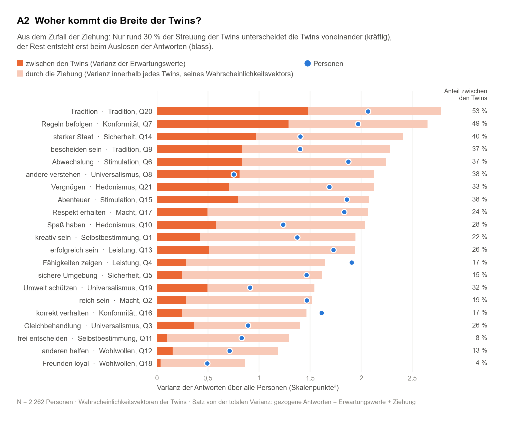

*Beschreibung.* Nur rund 30 % der Streuung der Twins unterscheidet die Twins voneinander; der Rest ist Zufall der Ziehung. Nach dem Satz von der totalen Varianz ist die Varianz der gezogenen Antworten die Varianz der Erwartungswerte zwischen den Twins plus die mittlere Varianz innerhalb eines Wahrscheinlichkeitsvektors (Doku 4.7.4). Kräftig = zwischen den Twins, blass = Ziehung, blauer Punkt = Varianz der Personen; die Zahl ist der Anteil zwischen den Twins.

Varianz je Frage im Mittel: Personen 1,40, Twins zwischen den Erwartungswerten 0,57 und durch die Ziehung 1,30. Einschränkung: Auch die Antworten der Personen sind eine einzelne, messfehlerbehaftete Antwort. Gezogen ist der Vergleich Antwort gegen Antwort, die Erwartungswerte zeigen die Unterschiede zwischen den Twins ohne Ziehung; der Kollaps ist damit eher etwas überzeichnet.

## Ebene 2 · Population ↔ Population

### 2.0 Gibt es Milieus?
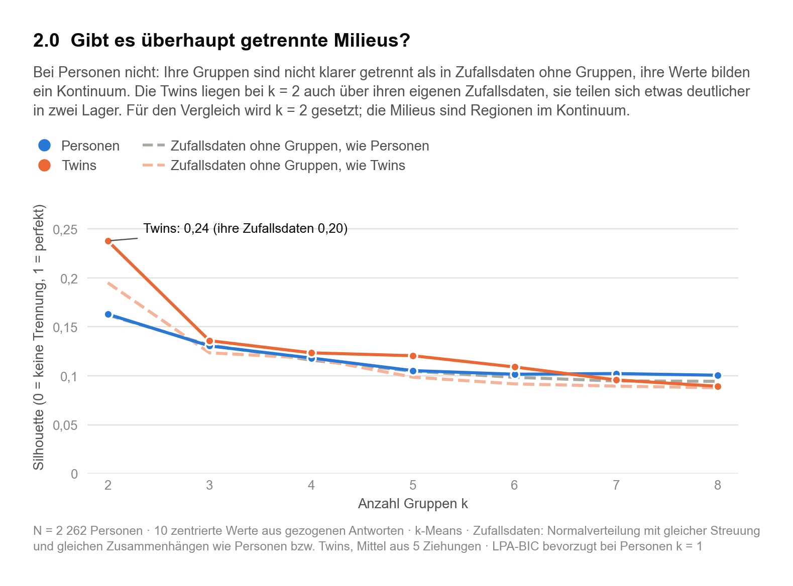

*Beschreibung.* Bei Personen nicht: Ihre Silhouette (0,16 bei k = 2) liegt genau auf der von Zufallsdaten ohne Gruppen, die Twins spalten sich dagegen in zwei Lager (0,24). Die Silhouette misst, wie klar Gruppen getrennt sind (0 = gar nicht, 1 = perfekt); ein Gruppierungsverfahren findet immer Gruppen, deshalb braucht es die Prüfung. Die graue Linie zeigt künstliche Daten mit gleicher Streuung und gleichen Zusammenhängen, aber garantiert ohne Gruppen; was darüber liegt, ist echte Struktur.

Gegen Zufallsdaten nach Vorbild der Twins (gleiche Kovarianz wie sie) liegen die Twins bei k = 2 nur knapp darüber (0,24 gegen 0,20): Ein Teil der Spaltung liegt an der Form der Twin-Wolke. Mit Erwartungswerten statt gezogenen Antworten ist die Spaltung der Twins noch deutlicher (Silhouette 0,44): Die Ziehung verwischt sie nur. Auch die LPA mit voller Kovarianz bevorzugt bei den Personen k = 1; mit diagonaler Kovarianz sinkt das BIC monoton (`lpa_bic.csv`). Die diagonale LPA nimmt an, dass die Werte innerhalb eines Milieus unabhängig sind; zentrierte Werte hängen aber per Konstruktion negativ zusammen (der persönliche Mittelwert ist abgezogen). k = 2 ist deshalb eine Setzung, keine Schätzung; die Milieus sind als Regionen im Kontinuum zu lesen. Die Silhouette wird mit k-Means gerechnet, die Milieus mit der LPA; für die LPA-Lösung selbst ergibt sich praktisch dieselbe Silhouette (Personen 0,16, Twins 0,24).

### 2.1 Milieus im Wertekreis
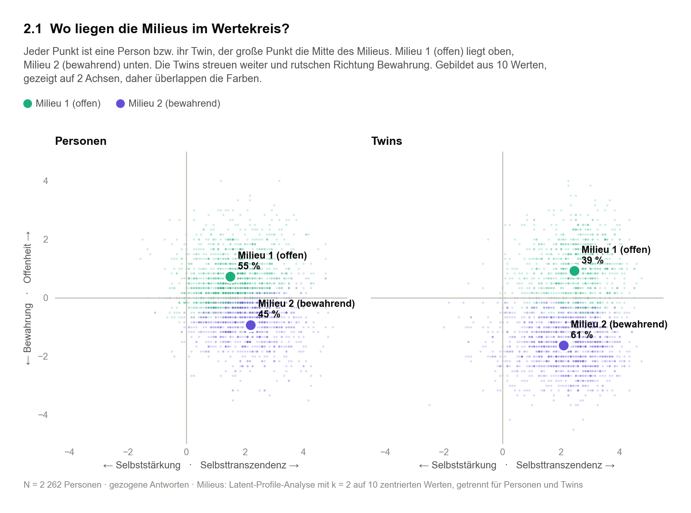

*Beschreibung.* Milieu 1 (offen) liegt oben, Milieu 2 (bewahrend) unten; die Twins streuen weiter und rutschen Richtung Bewahrung. Ein Milieu ist hier eine Gruppe aus der Latent-Profile-Analyse mit k = 2 im Raum der 10 zentrierten Werte, getrennt für Personen und Twins gebildet, kein soziales Milieu; jedes Twin-Milieu wird dem Personen-Milieu mit dem nächstgelegenen Mittelpunkt zugeordnet. Achsen: rechts Selbsttranszendenz, links Selbststärkung, oben Offenheit, unten Bewahrung; weil 10 Werte auf 2 Achsen gezeigt werden, überlappen die Farben.

### 2a Lage
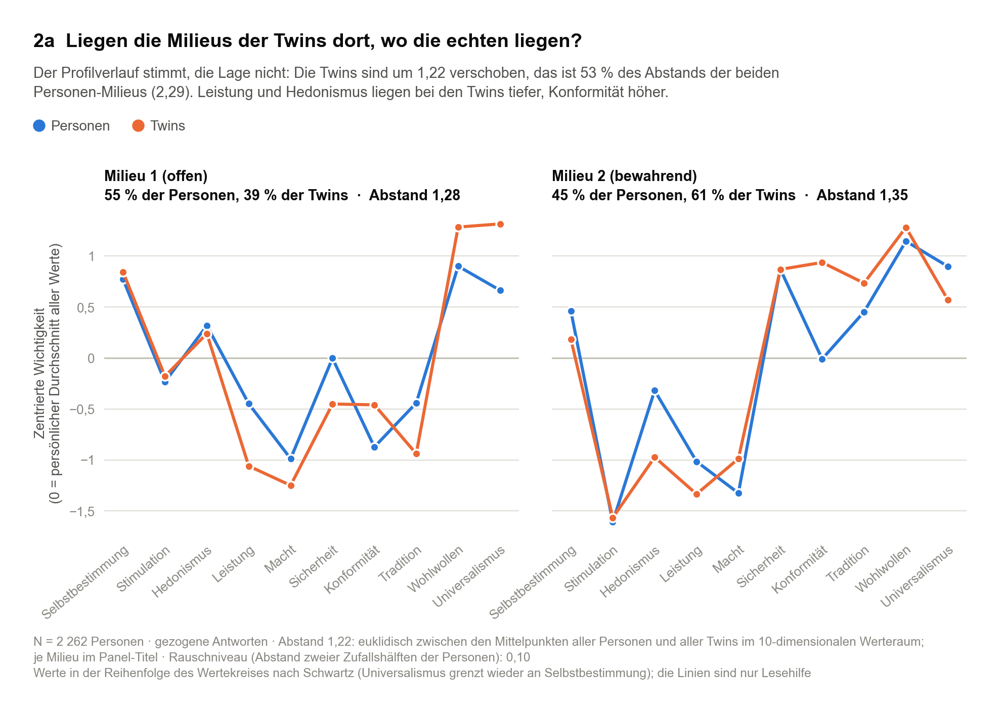

*Beschreibung.* Der Profilverlauf stimmt, die Lage nicht: Der Mittelpunkt aller Twins liegt 1,22 vom Mittelpunkt aller Personen entfernt, das sind 53 % des Abstands der beiden Personen-Milieus untereinander (2,29). Abstand = euklidische Entfernung im 10-dimensionalen Werteraum, zwischen den Gesamt-Mittelpunkten (je Milieu 1,28 bzw. 1,35). Die y-Achse zeigt die zentrierte Wichtigkeit, 0 = persönlicher Durchschnitt aller Werte; Hedonismus wird vor allem in Milieu 2 (bewahrend) unterschätzt.

Das Rauschniveau (Abstand zweier Zufallshälften der Personen, 0,10) zeigt nur, dass der Unterschied echt ist; wie groß er ist, zeigt der Vergleich mit dem Milieuabstand. Die Größen kippen: Milieu 1 (offen) umfasst 55 % der Personen, aber nur 39 % der Twins.

### 2b Streuung
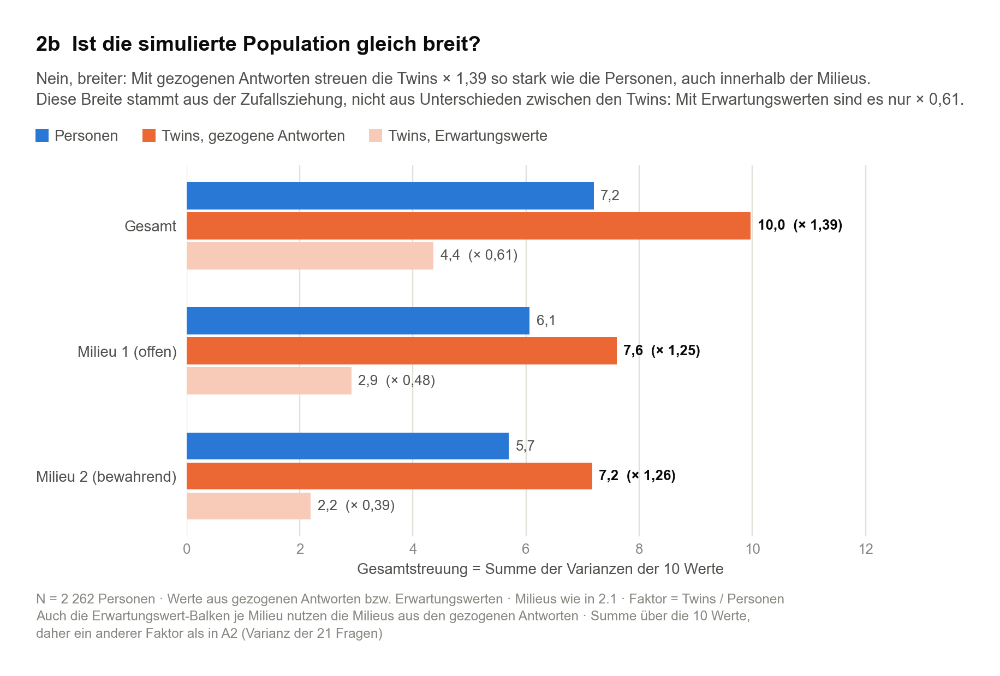

*Beschreibung.* Mit gezogenen Antworten streuen die Twins × 1,39 so stark wie die Personen, mit Erwartungswerten nur × 0,61. Gesamtstreuung = Summe der Varianzen der 10 Werte; 7,2 entspricht einer Standardabweichung von etwa 0,85 je Wert, 10,0 etwa 1,0. Gesamt ist die Streuung größer als innerhalb der Milieus, weil die Twin-Milieus weiter auseinanderliegen (passt zu 2.0). Der Faktor weicht von A2 ab, weil hier über die 10 Werte summiert wird statt über die 21 Fragen.

tr(Σ): Personen 7,20, Twins gezogen 9,97, Twins Erwartungswerte 4,36. Bures-Wasserstein (Abstand der ganzen Kovarianzmatrizen, nur Anhang): 0,77, das 4,5-Fache des Rauschens.

### 2d Zuordnung
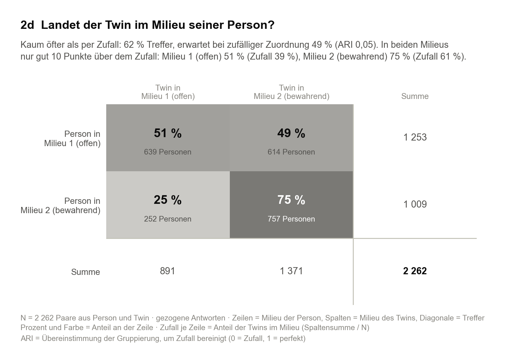

*Beschreibung.* Kaum öfter als per Zufall: 62 % der Twins landen im Milieu ihrer Person, bei zufälliger Zuordnung wären es 49 % (Anteil Personen × Anteil Twins je Milieu, summiert). Beide Milieus liegen nur gut 10 Prozentpunkte über ihrem Zufallswert (dem Anteil der Twins im jeweiligen Milieu). ARI = Übereinstimmung der Gruppierung, um Zufall bereinigt (0 = Zufall, 1 = perfekt), hier 0,05. Zeilen = Milieu der Person, Spalten = Milieu des Twins, Diagonale = Treffer; Prozent und Farbe zeigen den Anteil an der Zeile.

Die schlechte Zuordnung liegt nicht an der Ziehung: Mit Erwartungswerten landen 63 % im Milieu ihrer Person (ARI 0,07). Robustheit: ARI k-Means 0,077, Twins im Personen-Modell 0,061; alle über der Permutations-Null, aber nahe 0.

## Fazit 3 · Werte oder Demografie?
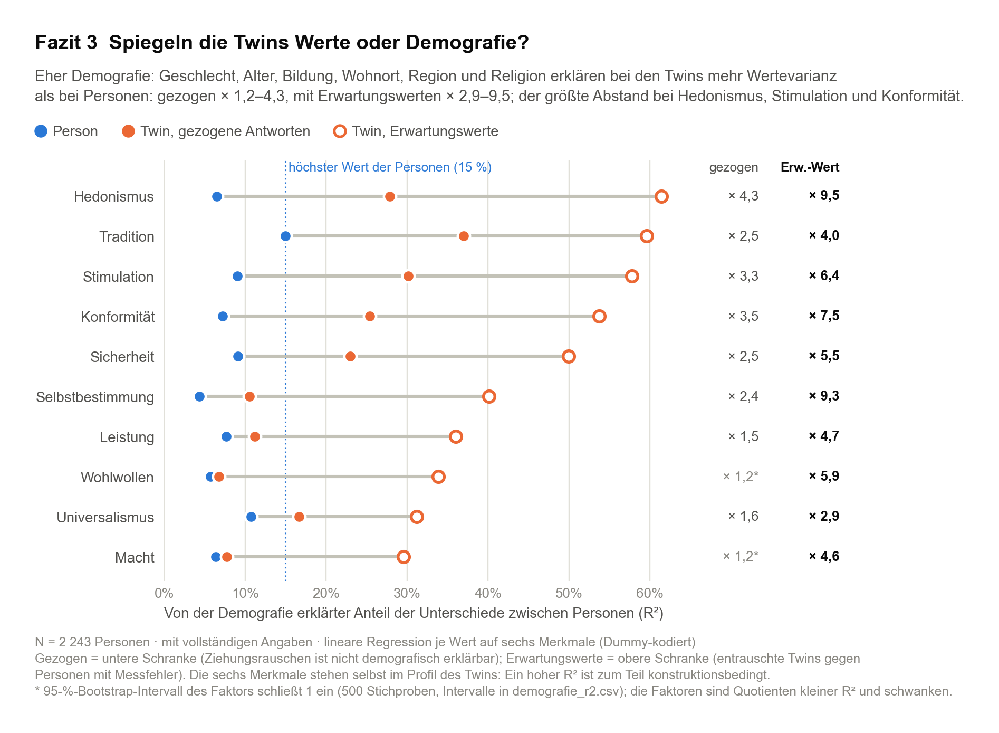

*Beschreibung.* Eher Demografie: Sechs Merkmale erklären bei den Twins mehr Wertevarianz als bei Personen, mit gezogenen Antworten bis 4,3-mal, mit Erwartungswerten bis 9,5-mal (größter Abstand in Prozentpunkten: Hedonismus, Stimulation, Konformität). R² = Anteil der Unterschiede zwischen Personen in einem Wert, den Geschlecht, Alter, Bildung, Wohnort, Region und Religion erklären. Ein hoher Twin-Wert heißt: Das Modell leitet Werte stärker aus der Demografie ab als echte Personen, also stereotyp.

Die Abbildung zeigt beide Varianten: gezogene Antworten (bis 4,3-mal) als untere Schranke, weil das Rauschen der Ziehung von der Demografie nicht erklärbar ist und R² drückt; Erwartungswerte als obere Schranke, weil dann entrauschte Twins mit messfehlerbehafteten Personen verglichen werden. Die sechs Merkmale stehen selbst im Profil des Twins; ein hoher R² ist deshalb zum Teil konstruktionsbedingt.

## Antwort auf die Hauptforschungsfrage

*In welchem Ausmaß reproduzieren LLM-generierte synthetische Befragte die multivariate Wertestruktur und die daraus abgeleitete personenzentrierte Segmentstruktur einer realen ESS-PVQ21-Stichprobe?*

1. **Person (FF1):** Der Twin liegt im Mittel 1,06 Skalenpunkte daneben, besser als ein fremder Twin, aber schlechter als der Demografie-Mittelwert (1a); 25 % der Twins schlagen ihn (A3). Die Rangfolge der Werte einer Person trifft er etwa so gut wie der Demografie-Mittelwert (individuelle Abweichung ρ̄ = 0,19 gegen 0,17, 1b; mit gezogenen Antworten 0,12 und damit darunter, siehe Sensitivitätsanalyse). Beim MAE verliert er wegen gerichteter Fehler: Hedonismus, Leistung und Stimulation unterschätzt er, Konformität überschätzt er (1c). Das LLM kennt die Person ein wenig, verschiebt sie aber zur vernünftigen, angepassten Durchschnittsperson.
2. **Population (FF2):** Die Personen bilden ein Kontinuum, die Twins spalten sich in zwei Lager (2.0). Die Milieus der Twins liegen verschoben (2a). Die simulierte Population wirkt breiter (tr(Σ) × 1,39, 2b), doch diese Breite stammt aus dem Zufall der Ziehung: Nur 30 % der Twin-Varianz unterscheidet die Twins voneinander (A2), ihre Erwartungswerte sind enger als die Personen (2b). Nur 62 % der Twins landen im Milieu ihrer Person (2d), und die Werte der Twins sind stark demografisch sortiert (Fazit 3). Als Ersatz für die reale Wertestruktur taugt die synthetische Stichprobe damit nur in groben Zügen.
3. **Was das Profil bringt:** Das volle Profil im Prompt bringt bei der Rangfolge der Werte etwas mehr als Geschlecht, Alter und Bildung, wenn man die Erwartungswerte des Twins nimmt, und etwas weniger, wenn man die gezogenen Antworten nimmt; beim Abstand zur Antwort bringt es in beiden Varianten weniger (1a, 1b). Ob die Anweisung gegen den Varianzkollaps die Twins weniger stereotyp macht, ist offen: Dafür fehlt der Vergleichslauf ohne diese Anweisung (DOKUMENTATION.md, Abschnitt 6).

## Anhang

### 1b′ Trennschärfe je Frage
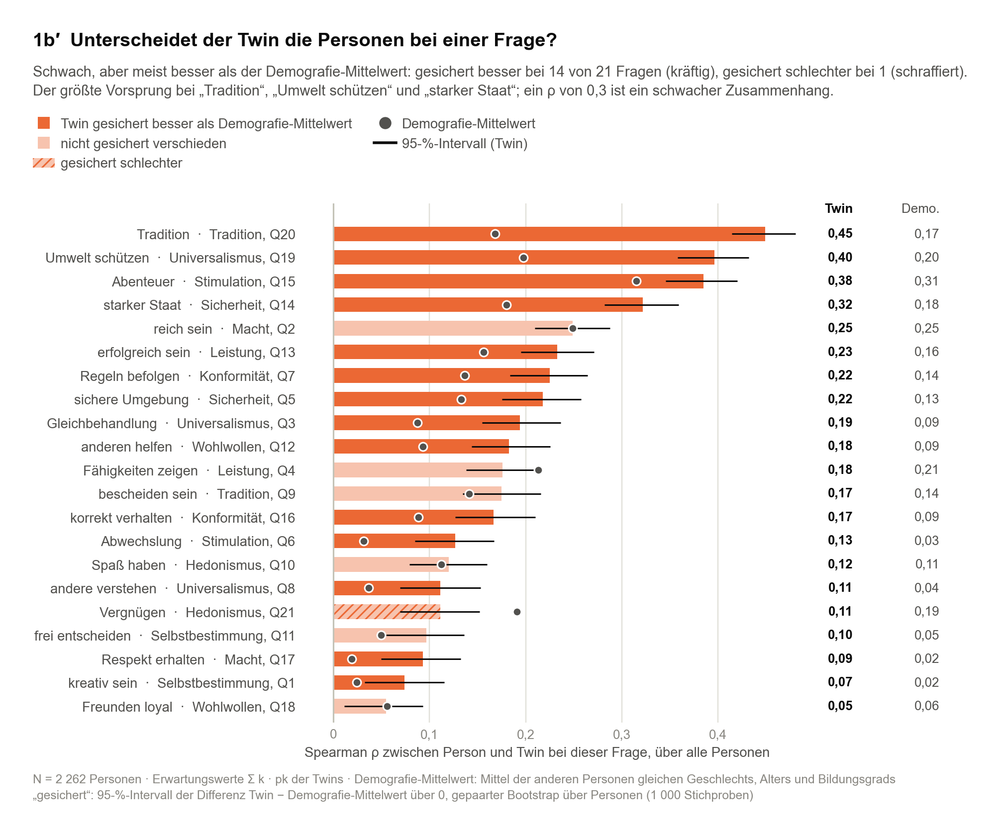

*Beschreibung.* Gesichert besser als der Demografie-Mittelwert ist der Twin bei 14 von 21 Fragen, gesichert schlechter bei 1 (Punktschätzer: besser bei 17, mit gezogenen Antworten bei 10). Praktisch gleichauf (Abstand < 0,01) liegen reich sein, Spaß haben, Freunden loyal. Hier wird eine Frage über alle 2262 Personen betrachtet, nicht eine Person über 21 Fragen; ein ρ von 0,3 ist ein schwacher Zusammenhang. Kräftig = 95-%-Intervall der Differenz Twin − Demografie-Mittelwert über 0 (gepaarter Bootstrap über Personen), schwarze Linie = Intervall des Twins, grauer Punkt = Demografie-Mittelwert; die Zahlen stehen in zwei Spalten rechts.

### 1d Subgruppen
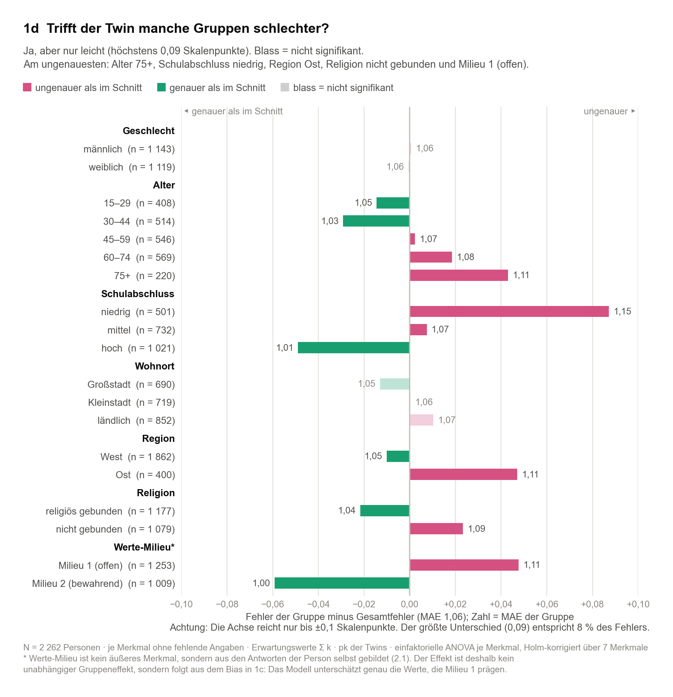

*Beschreibung.* Jeder Balken ist der Fehler der Gruppe minus Gesamtfehler, die Zahl daneben der MAE der Gruppe; Signifikanz per ANOVA mit Holm-Korrektur über die Merkmale. Pink = ungenauer, grün = genauer, blass = nicht signifikant; die Achse reicht nur bis ±0,1.

| Merkmal | η² | p (ANOVA, Holm) | p (Kruskal-Wallis) |
|---|---|---|---|
| Geschlecht | 0,000 | p = 0,920 | p = 0,893 |
| Alter | 0,007 | p = 0,009 | p = 0,006 |
| Schulabschluss | 0,039 | p < 0,001 | p < 0,001 |
| Wohnort | 0,001 | p = 0,462 | p = 0,145 |
| Region | 0,007 | p < 0,001 | p < 0,001 |
| Religion | 0,007 | p < 0,001 | p < 0,001 |
| Werte-Milieu | 0,040 | p < 0,001 | p < 0,001 |

Die Unterschiede sind klein. In der multiplen Regression erklären alle Merkmale zusammen R² = 5,7 % des Twin-MAE (signifikant nach Holm: Schulabschluss: mittel, Schulabschluss: hoch, Region: Ost, Religion: nicht gebunden).

### 1e Varianzkollaps innerhalb der Demografie
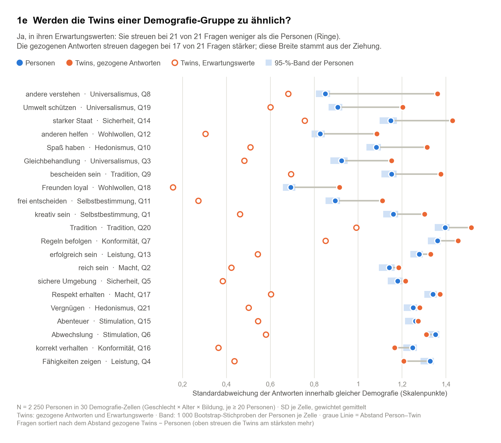

*Beschreibung.* Die gezogenen Antworten streuen bei 17 von 21 Fragen stärker als bei Personen, die Erwartungswerte der Twins aber bei 21 Fragen deutlich enger. Jeder Punkt ist die Standardabweichung der Antworten innerhalb gleicher Demografie (Geschlecht × Alter × Bildung, 30 Zellen mit mindestens 20 Personen), gemittelt über die Zellen. Blau = Personen mit 95-%-Bootstrap-Band, Orange = Twins (voll = gezogen, Ring = Erwartungswert). A2 zeigt dieselbe Aussage über alle Personen.

Within-Cell-SD: Twins gezogen 1,27, Personen 1,13, Twin-Erwartungswerte 0,53.

### 2c Form
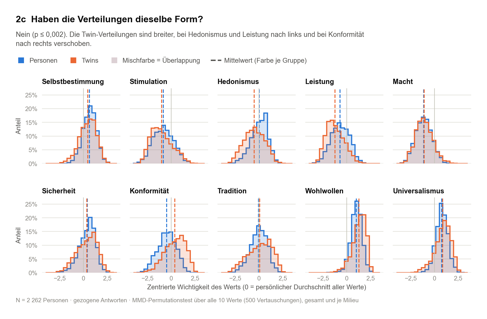

*Beschreibung.* Nein (p ≤ 0,002): Die Twin-Verteilungen sind breiter und bei Hedonismus und Leistung nach links, bei Konformität nach rechts verschoben. MMD vergleicht ganze Verteilungen ohne Annahme über ihre Form; im Permutationstest werden die Bezeichnungen Person/Twin 500-mal zufällig vertauscht. Bei N = 2 262 ist ein signifikanter Unterschied praktisch sicher; inhaltlich sagen 2a und 2b dasselbe. X-Achse: zentrierte Wichtigkeit; gestrichelte Linien = Mittelwerte, Mischfarbe = Überlappung.

### Sensitivitätsanalyse: Ebene 1 mit gezogenen Antworten

Dieselben Rechnungen wie in 1a–1d, einmal mit den Erwartungswerten des Twins (Hauptergebnis) und einmal mit den gezogenen Antworten des Laufs; der fremde Twin wird jeweils aus derselben Variante gebildet, die Vergleichsgrößen aus den Antworten der Personen bleiben gleich. Die Spanne zeigt dieselbe Kennzahl über 20 neue Ziehungen aus denselben Wahrscheinlichkeiten, ohne neuen Modellaufruf: Sie trennt die Wirkung der Wahl Erwartungswert/Ziehung von der Wirkung der einen Ziehung des Laufs. Zur Laufvariabilität des Modells sagt sie nichts. Alle Werte: `sensitivitaet_ebene1.csv`, `sensitivitaet_aussagen.csv`.

| Unterfrage | Kennzahl | Erwartungswert | gezogen | Spanne 20 neue Ziehungen |
|---|---|---|---|---|
| 1a | MAE Twin | 1,063 | 1,343 | 1,342 – 1,357 |
| 1a | MAE fremder Twin | 1,176 | 1,442 | 1,440 – 1,448 |
| 1a | MAE Demografie-Mittelwert | 0,924 | 0,924 | 0,924 – 0,924 |
| 1a | RMSE Twin | 1,335 | 1,747 | 1,745 – 1,760 |
| 1a | Anteil Twins genauer als fremder Twin | 74 % | 65 % | 63 % – 66 % |
| A3 | Anteil Twins genauer als Demografie-Mittelwert (MAE) | 25 % | 7 % | 6 % – 8 % |
| 1b | ρ Profil Twin (Mittel) | 0,496 | 0,356 | 0,346 – 0,356 |
| 1b | ρ individuelle Abweichung Twin (Mittel) | 0,191 | 0,115 | 0,103 – 0,118 |
| 1b | ρ individuelle Abweichung fremder Twin (Mittel) | 0,001 | 0,000 | -0,001 – 0,002 |
| 1b | ρ individuelle Abweichung Demografie-Mittelwert (Mittel) | 0,171 | 0,171 | 0,171 – 0,171 |
| 1b | Differenz ρ individuelle Abweichung Twin − Demografie-Mittelwert | 0,020 | -0,056 | -0,068 – -0,053 |
| 1b | Wilcoxon individuelle Abweichung Twin vs. Demografie-Mittelwert p | p = 0,016 | p < 0,001 | p < 0,001 – p < 0,001 |
| A3 | Anteil Twins mit ρ individuelle Abweichung > Demografie-Mittelwert | 51 % | 41 % | 39 % – 42 % |
| 1b′ | ρ je Frage Twin (Mittel) | 0,198 | 0,110 | 0,095 – 0,109 |
| 1b′ | ρ je Frage Demografie-Mittelwert (Mittel) | 0,128 | 0,128 | 0,128 – 0,128 |
| 1b′ | Fragen mit ρ Twin > Demografie-Mittelwert | 17 | 10 | 6 – 10 |
| 1c | ME gesamt | -0,301 | -0,305 | -0,309 – -0,295 |
| 1c | Fragen mit gerichtetem Fehler (Holm) | 16 | 16 | 15 – 17 |
| 1c | davon unterschätzt | 14 | 14 | 13 – 14 |
| 1c | Fragen mit gerichtetem Fehler nach Zentrierung (Holm) | 20 | 20 | 17 – 20 |
| 1d | η² Schulabschluss | 0,039 | 0,025 | 0,019 – 0,040 |
| 1d | Merkmale mit signifikantem MAE-Unterschied (Holm) | 5 | 4 | 3 – 6 |
| 1d | Regression MAE ~ Demografie R² | 0,057 | 0,043 | 0,035 – 0,058 |
| 1b′ | Fragen gesichert besser als Demografie-Mittelwert (Bootstrap) | 14 | 3 | – |
| 1b′ | Fragen gesichert schlechter als Demografie-Mittelwert (Bootstrap) | 1 | 6 | – |

**Welche Aussagen hängen von der Wahl ab?**

| Unterfrage | Aussage | Erwartungswert | gezogen | gezogen, Anteil neuer Ziehungen | hängt ab |
|---|---|---|---|---|---|
| 1a | Twin genauer als fremder Twin (MAE) | ja | ja | 100 % | nein |
| 1a | Twin genauer als Demografie-Mittelwert (MAE) | nein | nein | 0 % | nein |
| A3 | Mehrheit der Twins genauer als ihr Demografie-Mittelwert (MAE) | nein | nein | 0 % | nein |
| 1b | Twin enthält Information über die Person (individuelle Abweichung über fremdem Twin) | ja | ja | 100 % | nein |
| 1b | Twin trifft die individuelle Abweichung mindestens so gut wie der Demografie-Mittelwert | ja | nein | 0 % | **ja** |
| A3 | Mehrheit der Twins trifft die individuelle Abweichung besser als ihr Demografie-Mittelwert | ja | nein | 0 % | **ja** |
| 1b′ | Twin trennt die Personen bei der Mehrheit der Fragen besser als der Demografie-Mittelwert | ja | nein | 0 % | **ja** |
| 1c | Fehler bei der Mehrheit der Fragen gerichtet, überwiegend nach unten | ja | ja | 100 % | nein |
| 1d | Schulabschluss hängt spürbar mit dem MAE zusammen (η² ≥ 0,01) | ja | ja | 100 % | nein |

3 von 9 Aussagen hängen von der Wahl ab, und zwar in allen neuen Ziehungen gleich, also nicht wegen der einen Ziehung des Laufs. Betroffen ist nur der Vergleich mit dem Demografie-Mittelwert bei Rangfolge und Trennschärfe (1b, A3, 1b′): Mit Erwartungswerten liegt der Twin knapp vor dem Demografie-Mittelwert, mit gezogenen Antworten dahinter. Robust sind: Der Twin ist genauer als ein fremder Twin und enthält Information über die Person; er ist beim MAE schlechter als der Demografie-Mittelwert; seine Fehler sind überwiegend gerichtet (1c, der Mean Error ist in beiden Varianten in Erwartung gleich). Der Varianzkollaps (1e, A2) wird ohnehin in beiden Varianten berichtet, weil dort der Unterschied selbst der Befund ist. Der Vergleich mit gezogenen Antworten ist asymmetrisch: Nur der Twin trägt das Rauschen einer Ziehung, die Vergleichsgrößen sind Mittelwerte. Der Erwartungswert ist die passende Punktprognose, sofern die verbalisierten Wahrscheinlichkeiten halbwegs kalibriert sind (DOKUMENTATION.md, 5.3).
